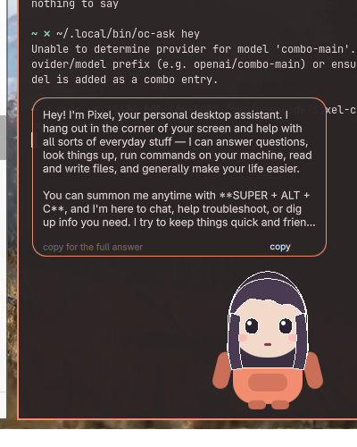

# Pixel — OpenCode Desktop Companion

A small AI assistant that lives in the corner of your Linux desktop. She answers questions, runs commands, and shows her feelings with expressions and emoji particles.



## What she does

- **Talks to your local OpenCode server** — shares the same conversation history as your TUI/web UI, or runs her own dedicated server
- **Shows expressions** — happy, love, sad, surprised, thinking, talking, idle — driven by mood tags in replies
- **Throws emoji particles** — mood-appropriate bursts that follow her feelings
- **Speaks in a formant synth voice** — "a-a-a-a" style game character speech, or use your own WAV samples
- **Accepts pictures** — hotkey attaches clipboard images or screenshots, automatically switches to a vision model
- **Hops and squashes** — little movements that make her feel alive
- **Draggable** — grab her anywhere and move her around; position persists across restarts
- **Fully customizable** — replace her sprite with your own art, add custom expressions, change her voice and personality

## Requirements

- **Linux** with Wayland (Hyprland tested, others should work)
- **[Quickshell](https://quickshell.outfoxxed.me/)** — the widget framework
- **[OpenCode](https://github.com/orcadive/opencode)** — the AI backend
- **Python 3.10+**
- **PipeWire** for audio (pw-play/pw-cat)
- Optional: **grim** for screenshots, **agentvoice** for voice input

## Installation

### 1. Copy files to their homes

```bash
# Helper scripts
cp bin/* ~/.local/bin/
chmod +x ~/.local/bin/oc-*

# Quickshell widget
cp -r quickshell/companion ~/.config/quickshell/

# Config and icon
mkdir -p ~/.config/oc-companion
cp config/config.example.json ~/.config/oc-companion/config.json
cp config/oc-companion.png ~/.local/share/icons/hicolor/128x128/apps/
```

### 2. Configure her personality

Edit `~/.config/oc-companion/config.json`:

```json
{
  "persona": "YOUR_PERSONA_HERE",
  "model": "YOUR_AI_MODEL_HERE",
  "agent": "Build",
  "server": "shared",
  "voice": true,
  "voiceRate": 15,
  "voicePitch": 1.0,
  "voiceBase": "bright"
}
```

**1. Replace `YOUR_PERSONA_HERE`** with who you want her to be. Example:

```json
"persona": "You are Pixel, a helpful desktop assistant. Keep replies short and friendly."
```

**2. Replace `YOUR_AI_MODEL_HERE`** with whatever opencode model you have. Example:

```json
"model": "openroute/kr/claude-sonnet-4.5"
```

The full default persona is in `config.example.json` — copy what you want.

### 3. Set up hotkeys

Add to your window manager config (Hyprland example in `~/.config/hypr/bindings.lua`):

```lua
-- Companion hotkeys
bind("SUPER ALT", "C", function() -- summon
  os.execute("oc-companion show &")
end)
bind("SUPER ALT", "A", function() -- ask about selection
  os.execute("oc-quick &")
end)
bind("SUPER ALT", "I", function() -- attach image
  os.execute("oc-companion attach &")
end)
```

Adapt these paths and syntax for your window manager.

### 4. Start her

```bash
oc-companion start
```

She appears in your system tray and in the corner of your screen. Right-click the tray icon for quick actions.

## Usage

- **Click her** to open the input box
- **Type and press Enter** to send a message
- **Drag her** to move her around
- **Tap her** while the bubble is visible for a little hop
- **Tray icon** → right-click for menu (Ask, New conversation, Copy last reply, Hide, Settings)

### Commands

```bash
oc-companion                    # toggle show/hide
oc-companion start              # start the widget
oc-companion stop               # quit
oc-companion ask "question"     # send a message
oc-companion mood happy         # preview an expression
oc-companion reload             # re-read config and artwork
oc-companion voice toggle       # mute/unmute

oc-ask "question"               # CLI interface to OpenCode
oc-ask --attach image.png "..."  # send with picture
oc-quick                        # selection → AI → clipboard
oc-voice "hello"                # speak a line
oc-attach                       # grab clipboard/screenshot
```

## Customization

### Your own artwork

Drop PNG/GIF/WebP files into `~/.config/quickshell/companion/`:

```
character.png              base sprite
character-happy.png        mood-specific sprites
character-love.png
character-sad.png
character-surprised.png
character-thinking.png
character-angry.png        custom expressions work too!
```

Run `oc-companion reload` to apply. No base file needed — per-mood sprites work alone.

### Custom expressions

Any name works:

```bash
cd ~/.config/quickshell/companion
cp character.png character-angry.png    # draw over it
oc-companion reload
oc-companion mood angry                 # preview it
```

She learns them automatically — `oc-ask` scans this folder and tells her which expressions she has. Use `[mood:angry]` in replies and she'll wear that face.

### Change the tap sound

Drop a sound file here:

```
~/.config/oc-companion/sfx/click.wav
```

Supports `.wav`, `.ogg`, `.flac`, `.mp3`. To use a different sound:

```json
{ "clickSound": "pop" }
```

Then `oc-companion reload`.

### Voice samples

Replace the synth with real samples (16-bit 48kHz mono WAV):

```
~/.config/oc-companion/voice/a.wav
~/.config/oc-companion/voice/b.wav
~/.config/oc-companion/voice/squeak.wav  (random pool)
```

Letter-named files play for that letter; other names form a pool for unmapped letters.

### Configuration reference

`~/.config/oc-companion/config.json`:

| Key | Purpose | Default |
|-----|---------|---------|
| `persona` | Her personality and instructions | (built-in) |
| `agent` | OpenCode agent name | `Build` |
| `model` | Which model to use (provider/model format) | (agent's default) |
| `server` | `shared` or `dedicated` | `shared` |
| `voice` | Enable/disable voice | `true` |
| `voiceRate` | Syllables per second | `15` |
| `voicePitch` | Pitch multiplier | `1.0` |
| `voiceBase` | Preset: `bright`/`soft`/`deep`/`chip`/`robot` | `bright` |
| `clickSound` | Which sound plays on tap | `click` |
| `typeSpeed` | Milliseconds per character | `65` |
| `bubbleIdle` | Seconds before bubble fades | `25` |
| `visionModel` | Model for picture messages | `opencode/nemotron-3.5-super-vl-free` |
| `timeout` | Reply timeout in seconds | `300` |

Changes apply with `oc-companion reload` (except QML edits, which need a restart).

To find available models, run:
```bash
oc-ask --help  # Shows how to query models
# Or check your OpenCode dashboard
```

Use the format `provider/model`, e.g. `omniroute/kr/claude-haiku-4.5`.

## Architecture

- **shell.qml** — the main widget (panel, drag, IPC, voice lifecycle)
- **Character.qml** — the drawn chibi with mood faces
- **Bubble.qml** — speech bubble and input
- **Particles.qml** — emoji particle system
- **oc-ask** — talks to OpenCode server, applies persona
- **oc-voice** — formant synthesizer with sample support
- **oc-companion** — wrapper script (start/stop/IPC)
- **oc-tray** — system tray icon with DBusMenu
- **oc-voice-bridge** — endpoint for agentvoice integration

State lives in `~/.local/state/oc-companion/`:
- `position.json` — where she sits
- `session.json` — conversation ID
- `server.json` — OpenCode server info
- `workspace/` — her working directory

## Troubleshooting

**Widget won't start**
- Check Quickshell is installed: `quickshell --version`
- Check logs: `~/.local/share/quickshell/by-id/*/log.qslog`

**She doesn't respond**
- Check OpenCode server: `opencode serve` running?
- Test directly: `oc-ask "hello"`
- Check `~/.local/state/oc-companion/server.json` exists

**Custom art not showing**
- Files must be **exactly** `character.png` or `character-<mood>.png` (no underscores, no capitals)
- Run `oc-companion reload` after adding files
- Check names: `ls ~/.config/quickshell/companion/character*`

**Voice is silent**
- Check `"voice": true` in config
- Check PipeWire: `pw-play /usr/share/sounds/freedesktop/stereo/bell.oga`
- Run `oc-companion reload` after config changes

**Tray icon missing**
- Icon must be at `~/.local/share/icons/hicolor/128x128/apps/oc-companion.png`
- Update icon cache: `gtk-update-icon-cache ~/.local/share/icons/hicolor/`
- Restart tray: `pkill -f oc-tray; oc-companion start`

## Integration examples

### Hyprland keybinds

```lua
-- ~/.config/hypr/bindings.lua
bind("SUPER ALT", "C", function() os.execute("oc-companion show &") end)
bind("SUPER ALT", "A", function() os.execute("oc-quick &") end)
bind("SUPER ALT", "I", function() os.execute("oc-companion attach &") end)
```

### Voice input with agentvoice

In `~/.config/omarchy/shell.json`:

```json
{
  "agentvoice": {
    "endpoint": "http://127.0.0.1:7676",
    "wakePhrase": "hey pixel"
  }
}
```

Then `F8` (hold) to speak to her.

### Steam integration

```bash
oc-steam list                    # installed games
oc-steam play "Game Name"        # launch
```

She knows these commands — just ask "launch Half-Life 2".

## Credits

Built with [Quickshell](https://quickshell.outfoxxed.me/) and [OpenCode](https://github.com/orcadive/opencode).

Voice synthesis inspired by game character speech systems — not TTS, just formant bursts.

## License

MIT — do what you want with it. If you draw a sprite you're proud of, share it!
